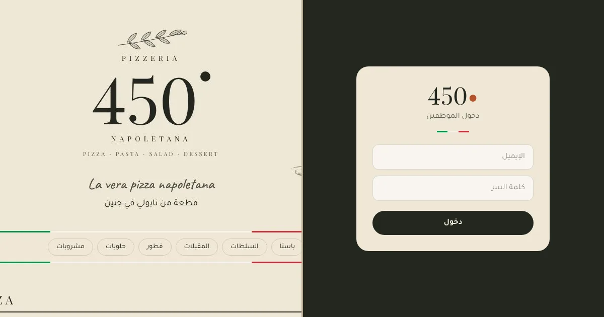

# Pizzeria 450° — Restaurant Ordering System

QR menu, live kitchen screen and cashier in one app, built on Supabase.

**Live:** [pizzeria-450-system.vercel.app](https://pizzeria-450-system.vercel.app) · Part of my [portfolio](https://aya-khamaysa-portfolio.vercel.app)



## Highlights

- **`/` Customer menu:** order from the table by QR code (dine-in with table number) or takeaway.
- **`/kitchen` Live orders** in three lanes: new, preparing, ready, updated in real time (staff login).
- **`/cash` Cashier:** open bills grouped by table, takeaway orders, settle payment (staff login).
- **Secure database:** prices are calculated inside the database (`submit_order`), never trusted from the browser. Row Level Security lets customers only read the menu and submit orders.
- **Sales history kept:** paid orders stay in the database (`paid_at`).

## Built with

React · React Router · Supabase (PostgreSQL, Auth, Realtime, RLS) · Tailwind CSS · Vite

## Setup

**1. Database (once).** In Supabase → SQL Editor → New query, run:
1. `supabase/setup-450.sql`
2. `supabase/seed-450-menu.sql` (the menu)

**2. Staff account.** Supabase → Authentication → Users → **Add user** (email and password). This account is used for the kitchen and the cashier.

**3. Environment.** Create a `.env` file with the Supabase project URL and the public (publishable) key. Never put the `service_role` key here, and never commit `.env`.

**4. Run.**

```bash
npm install
npm run dev
```

- Menu: http://localhost:5173
- Kitchen: http://localhost:5173/kitchen
- Cashier: http://localhost:5173/cash

## Edit
- Menu: Supabase → Table Editor → `categories` and `products` (`is_available = false` hides an item).
- Restaurant name, contact and number of tables: `src/config.js`

---

Designed & built by **Aya Khamaysa** · [Portfolio](https://aya-khamaysa-portfolio.vercel.app) · [LinkedIn](https://www.linkedin.com/in/ayakhamaysa) · [One Click](https://www.instagram.com/oneclick.ps)
